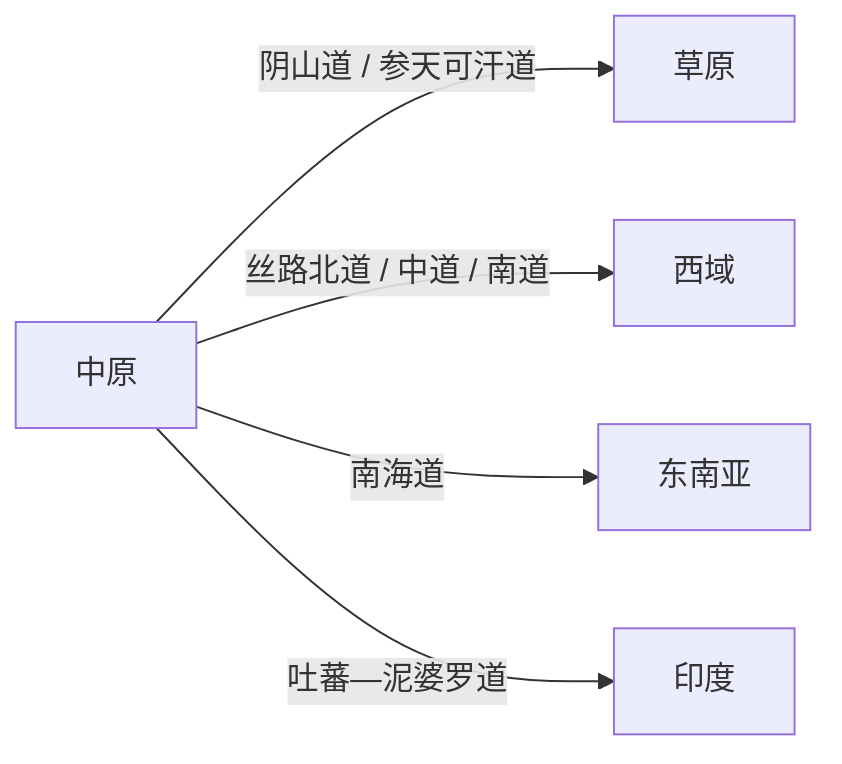

# 域外势力总览

> [!quote]
> 中原的每一次统一，都不是在真空中完成的：北边有狼旗，西边有驼队，南边有海船，西南有象军。

> [!info] 地图图层
> 28 个域外势力已按**草原 / 西域 / 东南亚 / 印度**四组叠加到 [[07_势力/00_势力地图与动向图|势力地图与动向图]]；可分别开关，点击势力范围看领袖、中心与中原关系。

## 四至

## 势力总表（28）

## 草原（9）

| 势力 | 领袖 | 中心 | 通道 | 与中原关系 |
|---|---|---|---|---|
| [[07_势力/03_域外势力/01_草原/X01-东突厥\|东突厥]] | 颉利可汗 / 突利可汗 | 漠北—阴山—定襄 | 阴山道 / 参天可汗道 | 隋末胁唐，630 年为唐所灭 |
| [[07_势力/03_域外势力/01_草原/X02-西突厥\|西突厥]] | 统叶护可汗 / 乙毗咄陆可汗 | 碎叶—伊犁—中亚草原 | 丝路北道 / 碎叶川 | 控制西域城邦，657 年为唐所灭 |
| [[07_势力/03_域外势力/01_草原/X03-薛延陀\|薛延陀]] | 夷男（真珠可汗） | 漠北—郁督军山 | 漠北—阴山—参天可汗道 | 646 年为唐所灭 |
| [[07_势力/03_域外势力/01_草原/X04-回纥\|回纥]] | 吐迷度 / 骨力裴罗（后世） | 漠北—鄂尔浑河 | 参天可汗道 | 唐羁縻；后世建回鹘汗国 |
| [[07_势力/03_域外势力/01_草原/X05-铁勒\|铁勒]] | 九姓铁勒诸部 | 漠北—金山（阿尔泰） | 漠北—金山—西域 | 唐羁縻，部分西迁 |
| [[07_势力/03_域外势力/01_草原/X06-契丹\|契丹]] | 大贺氏联盟 | 西拉木伦河—辽西 | 松漠—辽西—幽州 | 648 年唐置松漠都督府 |
| [[07_势力/03_域外势力/01_草原/X07-奚\|奚]] | 奚王（五部） | 饶乐水—辽西 | 饶乐—辽西—幽州 | 唐置饶乐都督府 |
| [[07_势力/03_域外势力/01_草原/X08-室韦\|室韦]] | 室韦诸部 | 大兴安岭—额尔古纳河 | 室韦道—营州 | 唐置室韦都督府 |
| [[07_势力/03_域外势力/01_草原/X09-靺鞨\|靺鞨]] | 粟末/黑水诸部 | 松花江—黑龙江—辽东 | 粟末水—营州—辽东 | 唐置黑水/渤海羁縻；698 年渤海国 |

## 西域（9）

| 势力 | 领袖 | 中心 | 通道 | 与中原关系 |
|---|---|---|---|---|
| [[07_势力/03_域外势力/02_西域/X10-高昌\|高昌]] | 麴文泰 | 高昌（吐鲁番） | 伊吾—高昌—焉耆（丝路中道） | 640 年唐灭高昌，置西州 |
| [[07_势力/03_域外势力/02_西域/X11-焉耆\|焉耆]] | 龙突骑支 | 焉耆（开都河） | 高昌—焉耆—龟兹（丝路中道） | 644 年为唐所平 |
| [[07_势力/03_域外势力/02_西域/X12-龟兹\|龟兹]] | 白苏伐叠 / 诃黎布失毕 | 龟兹（库车） | 焉耆—龟兹—疏勒（丝路北道） | 648 年唐平龟兹，置安西都护府 |
| [[07_势力/03_域外势力/02_西域/X13-于阗\|于阗]] | 尉迟氏 | 于阗（和田） | 鄯善—于阗—疏勒（丝路南道） | 唐安西四镇之一 |
| [[07_势力/03_域外势力/02_西域/X14-疏勒\|疏勒]] | 裴氏 | 疏勒（喀什） | 于阗—疏勒—葱岭（丝路南北道交汇） | 唐安西四镇之一 |
| [[07_势力/03_域外势力/02_西域/X15-粟特·康国\|粟特 / 康国]] | 昭武九姓 | 撒马尔罕（康国） | 撒马尔罕—碎叶—长安 | 昭武九姓商人/使节，唐羁縻 |
| [[07_势力/03_域外势力/02_西域/X16-吐火罗\|吐火罗]] | 突厥-吐火罗诸王 | 巴克特里亚（阿富汗北部） | 葱岭—吐火罗—罽宾 | 唐置月氏都督府（661） |
| [[07_势力/03_域外势力/02_西域/X17-波斯萨珊\|波斯萨珊]] | 伊嗣俟三世 / 卑路斯 | 泰西封—波斯 | 丝路西端—波斯—唐 | 651 年被大食灭；卑路斯奔唐 |
| [[07_势力/03_域外势力/02_西域/X18-石国\|石国]] | 石国王 | 塔什干 | 塔什干—碎叶—怛罗斯 | 唐羁縻；751 年怛罗斯之战导火索之一 |

## 东南亚（6）

| 势力 | 领袖 | 中心 | 通道 | 与中原关系 |
|---|---|---|---|---|
| [[07_势力/03_域外势力/03_东南亚/X19-林邑\|林邑]] | 林邑王 | 占城（越南中南部） | 南海道—占城—广州 | 605 年隋攻林邑；唐时朝贡/贸易 |
| [[07_势力/03_域外势力/03_东南亚/X20-真腊\|真腊]] | 真腊王 | 湄公河—洞里萨湖 | 湄公河—扶南—南海 | 唐时水真腊/陆真腊，南海贸易 |
| [[07_势力/03_域外势力/03_东南亚/X21-扶南\|扶南]] | 扶南王 | 湄公河三角洲—哥俄 | 扶南—湄公河—南海 | 7 世纪被真腊取代 |
| [[07_势力/03_域外势力/03_东南亚/X22-骠国\|骠国]] | 骠王 | 伊洛瓦底江—室利差呾罗 | 伊洛瓦底江—云南—唐 | 802 年骠国献乐于唐 |
| [[07_势力/03_域外势力/03_东南亚/X23-室利佛逝\|室利佛逝]] | 室利佛逝王 | 苏门答腊—马六甲 | 马六甲—广州（南海道） | 7 世纪南海佛国，义净在此译经 |
| [[07_势力/03_域外势力/03_东南亚/X24-诃陵\|诃陵]] | 诃陵王 | 爪哇—中爪哇 | 爪哇—南海—广州 | 唐时南海贸易/朝贡 |

## 印度（4）

| 势力 | 领袖 | 中心 | 通道 | 与中原关系 |
|---|---|---|---|---|
| [[07_势力/03_域外势力/04_印度/X25-戒日王朝\|戒日王朝]] | 戒日王（Harsha） | 曲女城（Kannauj）—摩揭陀 | 吐蕃—泥婆罗—曲女城 | 641 年遣使唐；647 年王玄策借兵 |
| [[07_势力/03_域外势力/04_印度/X26-帕拉瓦\|帕拉瓦]] | 帕拉瓦王 | 建志（Kanchipuram）—南印度 | 南印度—海路—南海 | 南印度海路强国，与唐间接贸易 |
| [[07_势力/03_域外势力/04_印度/X27-遮娄其\|遮娄其]] | 遮娄其王 | 巴达米（Badami）—德干 | 德干—海路/陆路 | 玄奘记载；与帕拉瓦争霸 |
| [[07_势力/03_域外势力/04_印度/X28-信度\|信度]] | 信度王公 | 印度河下游 | 印度河—西域—唐 | 唐使/商路；后受大食影响 |

## 通道与关系

| 片区 | 势力 | 主要通道 | 与中原关系 |
|---|---|---|---|
| 草原 | [[07_势力/03_域外势力/01_草原/X01-东突厥\|东突厥]] | 阴山道 / 参天可汗道 | 隋末胁唐，630 年为唐所灭 |
| 草原 | [[07_势力/03_域外势力/01_草原/X02-西突厥\|西突厥]] | 丝路北道 / 碎叶川 | 控制西域城邦，657 年为唐所灭 |
| 草原 | [[07_势力/03_域外势力/01_草原/X03-薛延陀\|薛延陀]] | 漠北—阴山—参天可汗道 | 646 年为唐所灭 |
| 草原 | [[07_势力/03_域外势力/01_草原/X04-回纥\|回纥]] | 参天可汗道 | 唐羁縻；后世建回鹘汗国 |
| 草原 | [[07_势力/03_域外势力/01_草原/X05-铁勒\|铁勒]] | 漠北—金山—西域 | 唐羁縻，部分西迁 |
| 草原 | [[07_势力/03_域外势力/01_草原/X06-契丹\|契丹]] | 松漠—辽西—幽州 | 648 年唐置松漠都督府 |
| 草原 | [[07_势力/03_域外势力/01_草原/X07-奚\|奚]] | 饶乐—辽西—幽州 | 唐置饶乐都督府 |
| 草原 | [[07_势力/03_域外势力/01_草原/X08-室韦\|室韦]] | 室韦道—营州 | 唐置室韦都督府 |
| 草原 | [[07_势力/03_域外势力/01_草原/X09-靺鞨\|靺鞨]] | 粟末水—营州—辽东 | 唐置黑水/渤海羁縻；698 年渤海国 |
| 西域 | [[07_势力/03_域外势力/02_西域/X10-高昌\|高昌]] | 伊吾—高昌—焉耆（丝路中道） | 640 年唐灭高昌，置西州 |
| 西域 | [[07_势力/03_域外势力/02_西域/X11-焉耆\|焉耆]] | 高昌—焉耆—龟兹（丝路中道） | 644 年为唐所平 |
| 西域 | [[07_势力/03_域外势力/02_西域/X12-龟兹\|龟兹]] | 焉耆—龟兹—疏勒（丝路北道） | 648 年唐平龟兹，置安西都护府 |
| 西域 | [[07_势力/03_域外势力/02_西域/X13-于阗\|于阗]] | 鄯善—于阗—疏勒（丝路南道） | 唐安西四镇之一 |
| 西域 | [[07_势力/03_域外势力/02_西域/X14-疏勒\|疏勒]] | 于阗—疏勒—葱岭（丝路南北道交汇） | 唐安西四镇之一 |
| 西域 | [[07_势力/03_域外势力/02_西域/X15-粟特·康国\|粟特 / 康国]] | 撒马尔罕—碎叶—长安 | 昭武九姓商人/使节，唐羁縻 |
| 西域 | [[07_势力/03_域外势力/02_西域/X16-吐火罗\|吐火罗]] | 葱岭—吐火罗—罽宾 | 唐置月氏都督府（661） |
| 西域 | [[07_势力/03_域外势力/02_西域/X17-波斯萨珊\|波斯萨珊]] | 丝路西端—波斯—唐 | 651 年被大食灭；卑路斯奔唐 |
| 西域 | [[07_势力/03_域外势力/02_西域/X18-石国\|石国]] | 塔什干—碎叶—怛罗斯 | 唐羁縻；751 年怛罗斯之战导火索之一 |
| 东南亚 | [[07_势力/03_域外势力/03_东南亚/X19-林邑\|林邑]] | 南海道—占城—广州 | 605 年隋攻林邑；唐时朝贡/贸易 |
| 东南亚 | [[07_势力/03_域外势力/03_东南亚/X20-真腊\|真腊]] | 湄公河—扶南—南海 | 唐时水真腊/陆真腊，南海贸易 |
| 东南亚 | [[07_势力/03_域外势力/03_东南亚/X21-扶南\|扶南]] | 扶南—湄公河—南海 | 7 世纪被真腊取代 |
| 东南亚 | [[07_势力/03_域外势力/03_东南亚/X22-骠国\|骠国]] | 伊洛瓦底江—云南—唐 | 802 年骠国献乐于唐 |
| 东南亚 | [[07_势力/03_域外势力/03_东南亚/X23-室利佛逝\|室利佛逝]] | 马六甲—广州（南海道） | 7 世纪南海佛国，义净在此译经 |
| 东南亚 | [[07_势力/03_域外势力/03_东南亚/X24-诃陵\|诃陵]] | 爪哇—南海—广州 | 唐时南海贸易/朝贡 |
| 印度 | [[07_势力/03_域外势力/04_印度/X25-戒日王朝\|戒日王朝]] | 吐蕃—泥婆罗—曲女城 | 641 年遣使唐；647 年王玄策借兵 |
| 印度 | [[07_势力/03_域外势力/04_印度/X26-帕拉瓦\|帕拉瓦]] | 南印度—海路—南海 | 南印度海路强国，与唐间接贸易 |
| 印度 | [[07_势力/03_域外势力/04_印度/X27-遮娄其\|遮娄其]] | 德干—海路/陆路 | 玄奘记载；与帕拉瓦争霸 |
| 印度 | [[07_势力/03_域外势力/04_印度/X28-信度\|信度]] | 印度河—西域—唐 | 唐使/商路；后受大食影响 |

## 三条读法

- **北线**：东突厥/西突厥/薛延陀/回纥/铁勒/契丹/奚/室韦/靺鞨——骑兵、草原联盟、参天可汗道。
- **西线**：高昌/焉耆/龟兹/于阗/疏勒/粟特/吐火罗/波斯/石国——绿洲、丝路、城邦、宗教。
- **南线与西南线**：林邑/真腊/扶南/骠国/室利佛逝/诃陵/戒日/帕拉瓦/遮娄其/信度——海路、稻米、香料、佛教。

## 写作口径

> 这些势力不是“隋唐的配角”，而是各自有王统、经济与军力的政治体。  
> 与中原的关系按“朝贡/贸易/战争/羁縻/宗教”分类，不把“朝贡”简单等同于“臣服”。

## 关联

- 势力与关系：[[00_入口/05_势力与关系|势力与关系]]
- 地图：[[07_势力/00_势力地图与动向图|势力地图与动向图]]
- 人物总览：[[00_入口/01_人物总览|人物总览]]
- 返回：[[00_入口/00_首页|大隋唐IP知识库]]

## 主要来源

- 《隋书·突厥传/西域传/南蛮传》
- 《旧唐书》《新唐书》突厥传、西戎传、南蛮传、天竺传
- 《大唐西域记》《大慈恩寺三藏法师传》
- 《唐会要》卷九十九/一百（四夷）
- 7—9 世纪南海诸国与隋唐关系研究

## 标签

#大隋唐/势力 #大隋唐/势力/域外 #大隋唐/MOC
